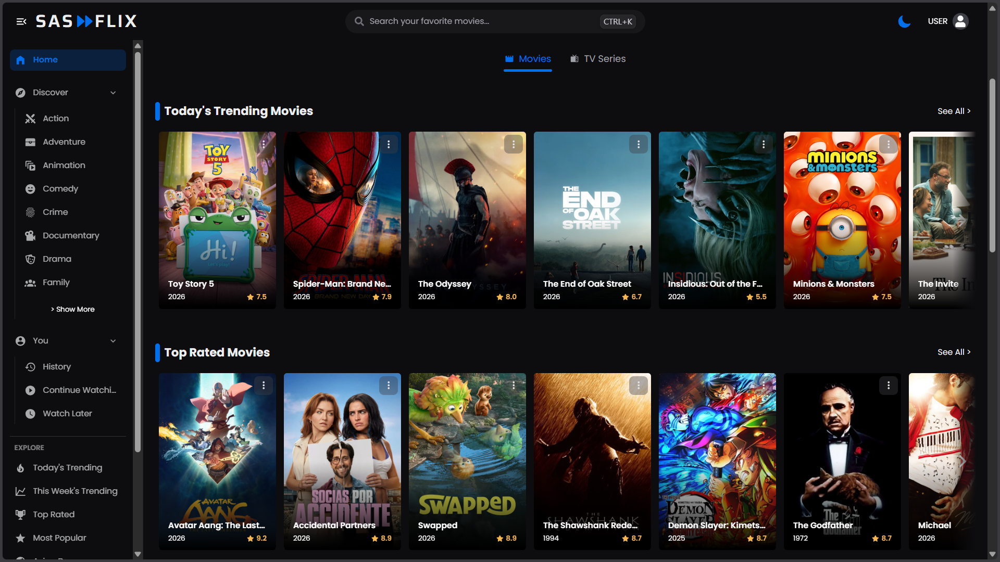

# SASHFLIX — Discover. Watch. Enjoy.

<div align="center">



**A modern, open-source streaming platform built for discovering and enjoying movies & TV shows.**

</div>

---

## 🎬 About SASHFLIX

**SASHFLIX** is a free, open-source movie and TV show streaming platform designed to make discovering and watching content simple, fast, and enjoyable.

Built with modern web technologies, SASHFLIX combines a clean, responsive interface with powerful discovery tools, personalized libraries, and a foundation designed to grow into a larger entertainment platform.

> **Built to explore. Designed to watch. Made to evolve.**

## ✨ Features

* **🆓 Free & Open Source** — Completely free to use, explore, and modify.
* **🎞️ Movie & TV Discovery** — Explore popular, trending, upcoming, and genre-based content.
* **🔍 Powerful Search** — Find movies, TV shows, actors, genres, and more.
* **📚 Personal Watchlist** — Save content you want to watch later.
* **🕘 Watch History** — Keep track of your viewing activity.
* **👤 User Accounts** — Create an account and access personalized features.
* **🌙 Light & Dark Mode** — Switch between themes based on your preference.
* **📱 Responsive Design** — Works across mobile, tablet, and desktop devices.
* **📲 Progressive Web App** — Install SASHFLIX on supported devices for an app-like experience.
* **⚡ Modern & Fast UI** — Designed around smooth navigation and a clean viewing experience.

## 🗺️ Project Status

| Feature              | Status         |
| -------------------- | -------------- |
| 🎬 Movie Discovery   | ✅ Completed    |
| 📺 TV Shows          | ✅ Completed    |
| 🔎 Search            | ✅ Completed    |
| 👤 User Accounts     | ✅ Completed    |
| 📚 Watchlist         | ✅ Completed    |
| 🕘 Watch History     | ✅ Completed    |
| 🌗 Theme System      | 🚧 In Progress |
| ⚙️ Personal Settings | 🚧 In Progress |
| 🏆 Achievements      | 📋 Planned     |
| 🌐 Social Features   | 📋 Planned     |

SASHFLIX is actively evolving, and its features may change as development continues.

## 🛠️ Built With

* **Next.js** — Application framework and routing
* **React** — UI architecture
* **TypeScript** — Type-safe application development
* **Tailwind CSS** — Responsive styling
* **Next UI** — UI components
* **TanStack Query** — Data fetching and caching
* **TMDB API** — Movie and TV metadata
* **Supabase** — Authentication and database
* **Vercel** — Deployment and hosting

## 🚀 Getting Started

### Prerequisites

Make sure you have:

* Node.js
* npm
* Git

You will also need the required API keys and service credentials.

### 1. Clone the repository

```bash
git clone https://github.com/sashendev/SASHFLIX.git
cd SASHFLIX
```

### 2. Install dependencies

```bash
npm install
```

### 3. Configure environment variables

Create your local environment file:

```bash
cp .env.example .env.local
```

Add the required API keys and configuration to `.env.local`.

### 4. Start the development server

```bash
npm run dev
```

### 5. Open the application

Visit:

```text
http://localhost:3000
```

## ⚖️ Disclaimer

SASHFLIX is an open-source software project intended for educational and development purposes.

Movie and TV metadata is provided through third-party services such as TMDB. SASHFLIX does not claim ownership of third-party movies, TV shows, artwork, trademarks, or other copyrighted material.

Users are responsible for ensuring that their use and deployment of SASHFLIX comply with applicable laws and the terms of the services they use.

## 📄 License

SASHFLIX is licensed under the **MIT License**.

See [LICENSE](LICENSE) for the complete license text.

---

<div align="center">

### 🍿 SASHFLIX

**Discover something worth watching.**

Made by **Sashen**

</div>
